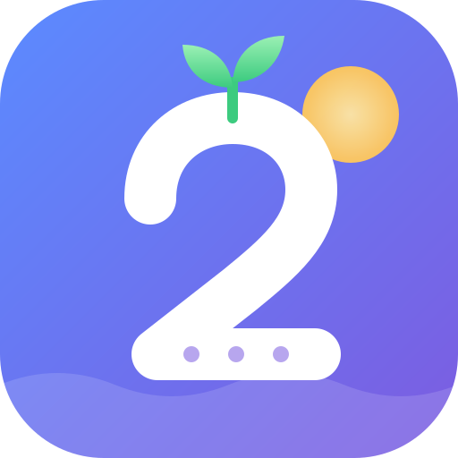
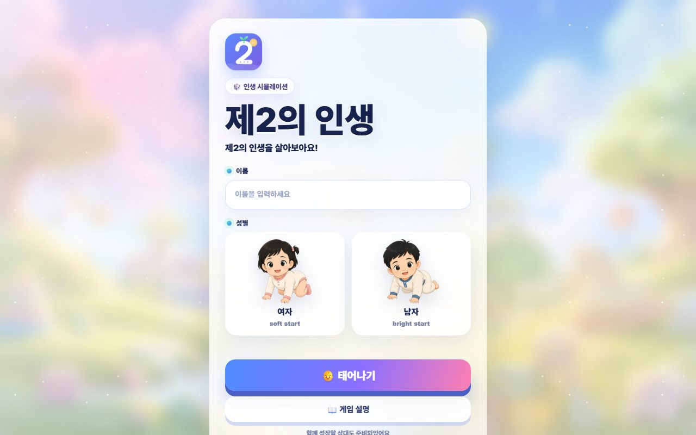
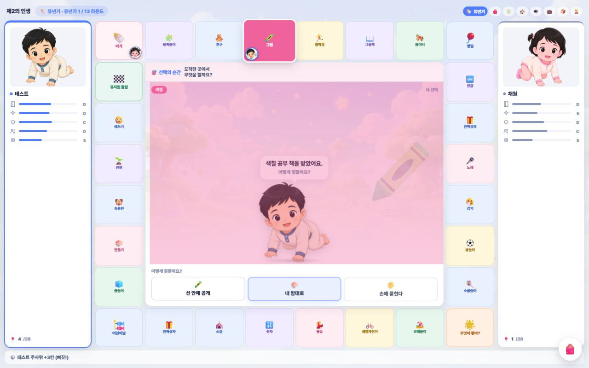
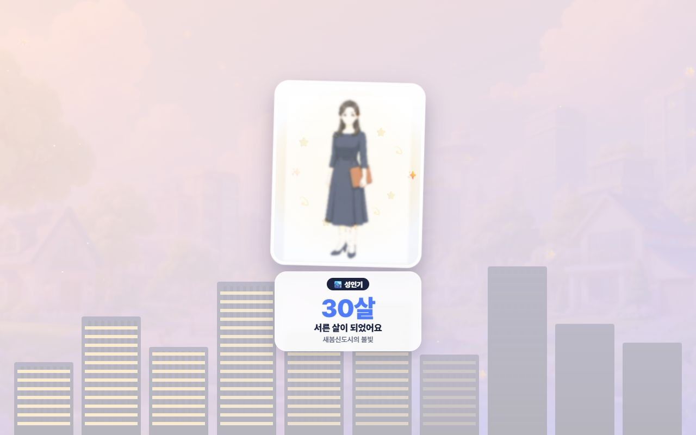
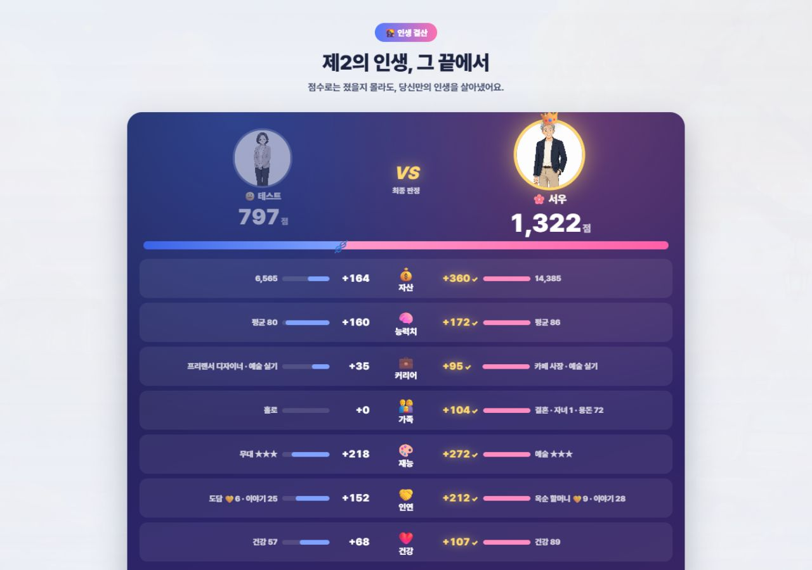

<p align="center"></p>

<h1 align="center">제2의 인생</h1>
<p align="center"><b>다섯 살부터 여든 살까지, 라이벌과 함께 주사위를 굴리며 살아보는 인생 보드게임</b><br>
바닷가 도시 <b>새봄시</b>에서 자라고, 사랑하고, 일하고, 늙어가는 75년.</p>

<p align="center"></p>

<p align="center"><a href="https://i0kyung.github.io/2nd-life/"><b>▶ 지금 바로 플레이하기</b></a></p>

> 📘 **[사용설명서 보기](docs/MANUAL.md)** — 조작법, 시대별 규칙, 결혼 · 자녀 · 직업, 결말 점수 계산, 자주 묻는 질문

## 어떻게 하는 게임인가요
- 7개 시대를 차례로 지나갑니다: **유년기 → 초등 → 중등 → 고등 → 청년 → 성인 → 노년**.
- 시대마다 정해진 횟수만큼 주사위(1~6)를 굴려 말판을 몇 바퀴든 돌고, 도착한 칸에서 선택을 합니다. 주사위는 **꾹 눌렀다 떼는 타이밍**으로 굴리고, 한 바퀴 돌 때마다 칸 배치가 새로 섞입니다.
- 선택은 지능 · 매력 · 건강 · 관계 · 운 5개 능력치와 돈, 연애, 직업, 가족, 재능에 쌓입니다.
- 성향이 다른 **라이벌**(AI)이 같은 시대를 함께 살아갑니다.
- 여든 살이 되면 **인생 점수 승부**가 열립니다: 자산 · 능력치 · 커리어 · 가족 · 재능 · 인연 · 건강 7개 부문을 실시간으로 계산해 승자를 가립니다.

| 말판 | 시대 전환 | 결말 승부 |
|---|---|---|
|  |  |  |

### 새봄시 세계관
- **평생 인연 3명:** 단짝 도담, 한결 선생님, 옥순 할머니. 유년기에 쌓은 인연이 노년의 이야기를 바꿉니다.
- **시대 사건 약 40개:** 길거리 캐스팅, 코인 열풍, 명예퇴직, 영끌, 보이스피싱 등. 일부는 운에 거는 승부 선택입니다.
- **새봄일보:** 4라운드마다 그 시대의 뉴스가 두 사람에게 각자 다르게 작용합니다.
- **시대 전환:** 시대마다 배경과 연출이 다릅니다(초등 벚꽃 · 중등 종이비행기 · 고등 별밤 · 청년 학사모 · 성인 도시 불빛 · 노년 노을).

## 실행하기
설치할 것이 없는 정적 웹페이지입니다.

```bash
# 아무 정적 서버나 괜찮아요
npx serve . -l 8000
# 또는
python -m http.server 8000
```
그다음 브라우저에서 `http://localhost:8000` 을 엽니다. `index.html`을 더블클릭해도 플레이할 수 있지만, 앱 설치와 오프라인 플레이는 서버로 열었을 때만 됩니다.

### 로딩 속도
- 그림(캐릭터 · 배경)은 화질을 유지한 채 **206MB → 41MB**로 줄였습니다. 화면에 보이는 크기에 맞춰 줄이고 팔레트 PNG로 압축했습니다.
- 한 시대를 플레이하는 동안 **다음 시대 화면 · 배경 · 내 캐릭터 그림을 미리 받아** 둡니다. 데이터 절약 모드에서는 미리 받지 않습니다.
- 한 번 받은 그림은 저장해 두므로 두 번째부터는 바로 뜹니다.

### 앱으로 설치 (PWA)
http(s)로 열면 주소창의 **설치** 버튼으로 홈 화면에 앱처럼 추가할 수 있습니다. 한 번 플레이한 화면과 그림은 저장되어 오프라인에서도 열립니다.

### GitHub Pages로 배포
1. 저장소 **Settings → Pages** 로 갑니다.
2. Source를 `Deploy from a branch`, 브랜치를 `main` / `(root)` 로 정합니다.
3. 1~2분 뒤 `https://<계정>.github.io/<저장소>/` 에서 열립니다.

모든 경로가 상대 경로라 하위 경로에서도 그대로 동작합니다.

## 폴더 구조
```
index.html              시작 화면 (이름 · 성별 · 규칙)
stage_*.html            7개 시대 화면 (각자 게임 엔진 포함)
result.html             인생 정산 · 결말 승부
world/                  새봄시 세계관 확장 (인연 · 시대 사건 · 새봄일보)
fx/                     공통 연출 (주사위 · 장면 전환 · 시대별 테마 배경)
icons/                  앱 아이콘 (SVG 원본 + PNG)
manifest.webmanifest    PWA 설정
sw.js · pwa.js          오프라인 캐시 · 등록
image/                  캐릭터 · 배경 그림
tools/sim/              자동 플레이 · 밸런스 시뮬레이션
GAME_DESIGN.md          설계 문서
docs/MANUAL.md          사용설명서
LICENSE                 저작권 고지 (All rights reserved)
```
게임 상태는 브라우저 `localStorage`(`secondLife_players`, `secondLife_gameState`, `secondLife_result`)에 저장됩니다.

## 밸런스 시뮬레이션
헤드리스 크롬으로 게임을 끝까지 자동 플레이하고 지표를 집계합니다.

```bash
cd tools/sim
npm install
npm run sim         # 12판: 가정형 · 커리어형 · 균형형 · 무작위 봇
npm run scores      # 결말 7개 부문 점수 분포
npm run transitions # 시대 전환 연출 스크린샷
```
- 크롬 경로가 다르면 `CHROME_PATH` 환경변수로 지정합니다.
- 봇 성향은 `BOT_PERSONA=family|career|balanced|random` 으로 정합니다. 성향별로 선택지 문구에 가중치를 주고, 20%는 일부러 변덕스럽게 고릅니다.

## 저작권
**© 2026 edagim29. All rights reserved.**

「제2의 인생」의 소스 코드, 그림(캐릭터 · 배경 · 아이콘), 기획 · 시나리오 · 문구 · 문서 등 모든 저작물의 저작권은 **edagim29**에게 있습니다.
저작권자의 사전 서면 허락 없이 복제 · 배포 · 수정 · 상업적 이용 · AI 학습 데이터로 쓰는 것을 금지합니다.
게임을 개인적으로 플레이하는 것과 저장소를 열람하는 것은 자유입니다. 자세한 내용은 [LICENSE](LICENSE)를 보세요.
